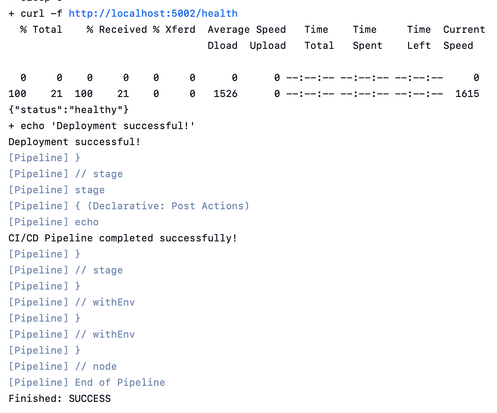
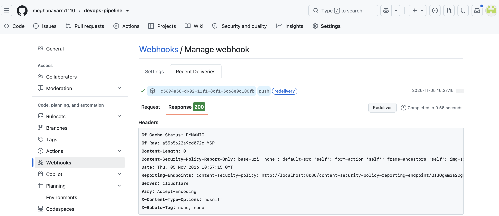
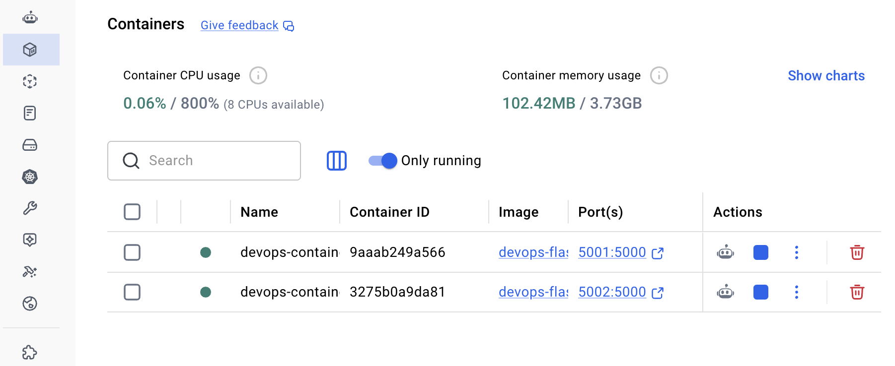
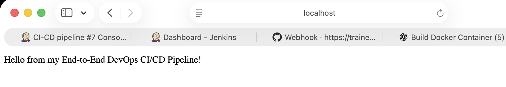
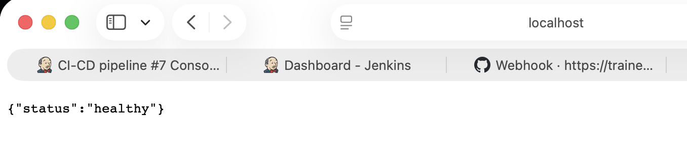

# 🚀 End-to-End DevOps CI/CD Pipeline

An end-to-end CI/CD project that automates the building, containerization, and deployment of a Flask application using **GitHub, Jenkins, Docker, and Cloudflare Tunnel**.

## 📌 Project Overview

This project demonstrates how to automate application deployment using a CI/CD pipeline.

Whenever code is pushed to the GitHub repository, a webhook triggers Jenkins. Jenkins fetches the latest source code, builds a Docker image, deploys the application in a Docker container, and verifies deployment using a health check.

## 🛠️ Technologies Used

- **Python** – Application development
- **Flask** – Web framework
- **Docker** – Containerization
- **Jenkins** – CI/CD automation
- **Git & GitHub** – Version control and source code management
- **Cloudflare Tunnel** – Webhook connectivity
- **Linux commands / Shell scripting** – Pipeline automation

## 🏗️ Project Architecture

```text
Developer
    |
    | Git Push
    v
  GitHub
    |
    | Webhook
    v
Cloudflare Tunnel
    |
    v
  Jenkins
    |
    | Checkout Source Code
    v
Build Docker Image
    |
    v
Deploy Docker Container
    |
    v
Flask Application
    |
    v
Health Check
```

## 📂 Project Structure

```text
devops-pipeline/
│
├── app/
│   ├── app.py
│   ├── Dockerfile
│   └── requirements.txt
│
├── screenshots/
│   ├── jenkins-success.png
│   ├── github-webhook.png
│   ├── docker-containers.png
│   ├── flask-application.png
│   └── health-check.png
│
├── Jenkinsfile
├── .gitignore
└── README.md
```

## ⚙️ CI/CD Pipeline Stages

1. **GitHub Integration** – Fetches the latest code from GitHub.
2. **Webhook Trigger** – Automatically triggers Jenkins when code is pushed.
3. **Python Check** – Verifies Python installation.
4. **Docker Check** – Verifies Docker installation.
5. **Docker Connection** – Checks Docker engine connectivity.
6. **Build Docker Image** – Builds the Flask application image.
7. **Deploy Application** – Runs the application inside a Docker container.
8. **Health Check** – Verifies that the deployed application is healthy.

## ▶️ Run the Application Locally

### 1. Clone the repository

```bash
git clone https://github.com/meghanayarra1110/devops-pipeline.git
cd devops-pipeline
```

### 2. Build Docker image

```bash
docker build -t devops-flask-app:latest ./app
```

### 3. Run Docker container

```bash
docker run -d \
  -p 5002:5000 \
  --name devops-container-ci \
  devops-flask-app:latest
```

### 4. Access the application

Main application:

http://localhost:5002/

Health check:

http://localhost:5002/health

Expected health response:

```json
{
  "status": "healthy"
}
```

## 🔄 Automation Workflow

```text
Code Change
    ↓
Git Commit
    ↓
Git Push
    ↓
GitHub Webhook
    ↓
Jenkins Pipeline
    ↓
Docker Image Build
    ↓
Container Deployment
    ↓
Health Check
    ↓
Successful Deployment
```

## ✅ Project Results

- Successfully integrated GitHub with Jenkins.
- Configured automatic Jenkins builds using GitHub webhooks.
- Successfully built a Docker image.
- Successfully deployed the Flask application.
- Verified application availability through the health endpoint.
- Successfully executed an automated CI/CD pipeline.

## 🎯 Key Learnings

- Understanding CI/CD concepts.
- Working with Git and GitHub.
- Creating and managing Docker containers.
- Writing Jenkins declarative pipelines.
- Configuring GitHub webhooks.
- Automating application deployment.
- Performing application health checks.

  ## Project Screenshots

### 1. Jenkins Successful Pipeline


### 2. GitHub Webhook Response


### 3. Docker Running Containers


### 4. Flask Application


### 5. Application Health Check


## 👩‍💻 Author

**Meghana Yarra**

GitHub: [@meghanayarra1110](https://github.com/meghanayarra1110)

---

⭐ If you find this project useful, feel free to explore the repository!
